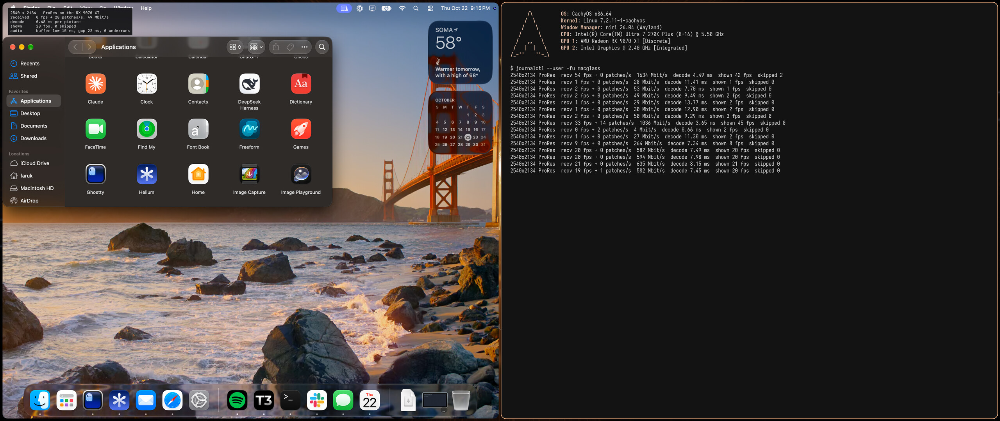
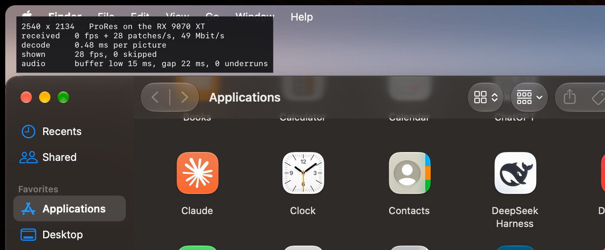

# MacGlass

A real Mac as a window on a Linux desktop, in the spirit of [Looking Glass](https://looking-glass.io):
the Mac gets a virtual display that matches the window's size pixel for pixel, its picture streams
over a Thunderbolt cable at visually lossless quality, and keyboard, mouse, clipboard, cursor and
audio go both ways. With the lid closed, the Mac's only screen is the window.

It also exposes the macOS Accessibility API one-to-one on the same link, so tools (and AI agents) on
the Linux side can inspect and drive Mac apps.

*Left: the Mac (an M5 Pro) in a MacGlass window, with the stats panel open (Right Ctrl + D). Right: a
terminal on the Linux PC following the viewer's log. The Mac's display is 2540x2134, the window's size
in pixels, and follows it as the window is resized.*

*A 1:1 crop of the same window: what you see is the Mac's own pixels, ProRes 4444 decoded on the RX
9070 XT. The panel shows the picture size, decoder, frames and patches received, decode time per
picture, frames shown and audio buffering.*

Built for one setup (a MacBook Pro M5 Pro, earlier an M1 Pro, on macOS 27, a CachyOS/niri PC with an Intel Arrow Lake iGPU
driving the display and an RX 9070 XT that a Windows VM sometimes takes), but most of it is generic.

## How it works

- **Mac (`mac/`, Swift):**
  - A `CGVirtualDisplay` (private API) whose single mode follows the client's window size; all
    other displays mirror it.
  - ScreenCaptureKit captures it as 10-bit 4:4:4 with dirty rectangles. Small changes go out as
    512×512 ProRes patches, the rest as full frames: ProRes 4444/422 HQ, or HEVC Main 4:4:4 10-bit
    when the client asks.
  - Plain TCP, bound to the Thunderbolt Bridge interface only.
  - Also: CGEvent input, the clipboard, the cursor shape and position, system audio, keeping the
    Mac awake with the lid closed, muting its speakers while connected.
  - Runs as a LaunchAgent.
- **Linux (`linux/`, C, SDL3 + OpenGL):**
  - Decodes ProRes on the discrete GPU through FFmpeg's Vulkan decoder, or HEVC on the Intel iGPU
    through VAAPI, drawn from the decoder's surfaces with no copy. The choice follows whether a VM
    has the discrete GPU. The CPU is the fallback.
  - Finds the Mac on the Thunderbolt link by itself, waits and reconnects, resizes the Mac's
    display with the window, and redraws only what changed.
  - Looking Glass-style controls on Right Ctrl, an on-screen overlay (waiting screen, alerts,
    stats, help), and a dot marking the Mac's cursor while input isn't captured.
- **Wire protocol:** `protocol.h`, mirrored by `mac/Sources/Protocol.swift`.
- **Accessibility proxy:** TCP port 47801 on the Thunderbolt link (and a Unix socket on the Mac).
  Newline-delimited JSON. Each request names a real function (`AXUIElementCopyAttributeValue`,
  `AXUIElementPerformAction`, `AXObserverAddNotification`, `CGEventPost`,
  `SCScreenshotManager.captureImage`, …) with its arguments, and gets that function's result or
  raw `AXError` back. See `mac/Sources/AXProxy.swift` for the format.

## Requirements

- A Thunderbolt cable between the machines, with networking on both ends: the Mac's Thunderbolt
  Bridge, and Linux's `thunderbolt_net`.
  - On the Linux side, load `thunderbolt_net` with `e2e=0`. With end-to-end flow control, traffic
    from the Mac triggered an Apple Silicon kernel panic ("DART PTE invalid") on an M1 Pro, and on
    an M5 Pro it dropped the link after ~25 s at full speed. To make it permanent:
    `echo 'options thunderbolt_net e2e=0' | sudo tee /etc/modprobe.d/thunderbolt-net.conf`
- **Mac:**
  - Xcode command line tools.
  - A code-signing identity. A Developer ID keeps the permissions across rebuilds; ad-hoc signing
    loses them every time.
  - Permissions for MacGlass: Screen Recording, and Accessibility ("Device Control and Data Access"
    on macOS 27).
  - For lid-closed use, a sudoers rule letting your user run `pmset` for exactly this, e.g. in
    `/etc/sudoers.d/macglass`:
    `youruser ALL=(root) NOPASSWD: /usr/bin/pmset -a disablesleep 0, /usr/bin/pmset -a disablesleep 1`
- **Linux:** SDL 3, FFmpeg (libavcodec/libavutil with Vulkan and VAAPI), Mesa EGL/GL, libdrm,
  FreeType, fontconfig.

## Build and install

- **Mac:** `open -a Terminal mac/build.command`. It builds, signs, installs
  `/Applications/MacGlass.app` and (re)starts the `dev.faruk.macglass` LaunchAgent. The log is in
  `~/Library/Logs/MacGlass.log`.
- **Linux:** `make -C linux install`. It installs:
  - `~/.local/bin/macglass`
  - the `macglass.service` user unit
  - `macglass-open`, which opens the window or focuses it (niri)
  - a desktop entry

  Run `macglass-open`, or `macglass [address [port]]` to skip discovery.

## Using it

- **Right Ctrl:**

  | Key | Does |
  |---|---|
  | tap | capture or release input |
  | hold | help |
  | + F | fullscreen |
  | + D | stats |
  | + C | codec (automatic / HEVC / ProRes) |
  | + R | reconnect |
  | + Q | quit |

- **Capture follows window focus.**
- **Environment overrides:**

  | Variable | Does |
  |---|---|
  | `MACGLASS_HOST` | the Mac's address, instead of discovering it |
  | `MACGLASS_CODEC` | `hevc` or `prores` |
  | `MACGLASS_DGPU_PCI`, `MACGLASS_DGPU_VULKAN` | which discrete GPU to use, and how to tell it's taken |
  | `MACGLASS_IGPU_NODE` | the VAAPI render node |
  | `MACGLASS_FONT` | the overlay font |
  | `MACGLASS_SHOW_STATS` | show the stats panel at start |
  | `MACGLASS_FULL_REDRAW` | turn off partial redraws |
  | `MACGLASS_DEBUG` | extra logging |

- `kill -USR1` the client to save what it shows to `/tmp/macglass-window.ppm`.
